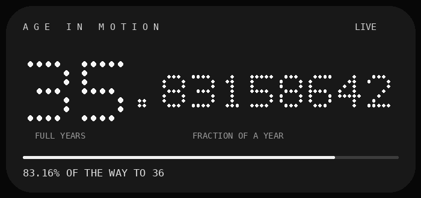
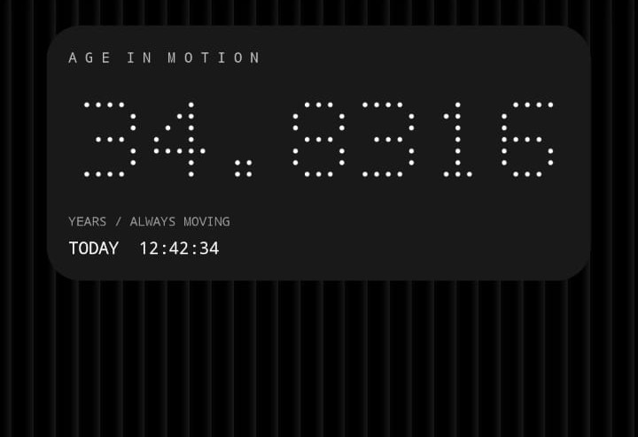

# Age in Motion — Smart Motion v3 (Nothing OS 3.2)

**An independent Android home-screen widget for Nothing Phone (1) and other compatible devices that cannot run the Nothing OS 4.0+ Playground edition.**

Inspired by **Rahul's original [Age in Motion](https://playground.nothing.tech/detail/app/A0iu5DKA7eGhHhZD)**. A huge salute and thanks to Rahul for the original idea. This independent compatibility project is **not an official Nothing widget**, endorsed by Nothing, or affiliated with Rahul.

## What it looks like

*Design preview showing a fictional age (35.83158642), not an actual user birth date. Layout adapts to the available home-screen widget space; 4 × 2 is recommended.*

### A user-provided screenshot from the earlier design

*The screenshot above documents the earlier layout. The v3 redesign adds the year/fraction labels and removes the confusing “TODAY” counter.*

## What does 35.83158642 mean?

It **does not mean 35 years, 83 months, or 15 seconds**. It means:

- **35** = full years lived (35 birthdays completed).
- **.83158642** = the fraction of the **current birthday-to-birthday year** already completed.
- **83.16% of the way to age 36** = the same fraction, expressed as an easy-to-understand progress percentage.

The changing final decimal digits give the widget its motion. A year of life is approximately 31.5 million seconds; the fraction is calculated from the previous birthday at midnight to the next birthday at midnight in the phone's local time zone, including leap-year differences. Exact decimals shown in screenshots will vary.

## New in v3

- Readable layout: **FULL YEARS** on the left; **FRACTION OF A YEAR** on the right.
- Clear **% of the way to your next birthday** and simple progress bar.
- Original black, monochrome 5×7 dot-matrix styling.
- **Smart Motion (opt-in)**: every 2 seconds for the first 90 seconds after unlock, then every 10 seconds, then pauses after 5 minutes until the next unlock. Android Battery Saver slows animation to 15-second updates.
- **Zero redraws while screen-off or phone locked**, no wakelock, and no app auto-start after reboot.
- Optional **lock-screen age notification** (off by default; phone notification settings determine visibility).
- New device screenshot in this README.
- Birthday stays local; no Internet permission, tracking, ads, analytics, or account.

### A truthful limitation about home-screen visibility

Ordinary third-party apps cannot reliably detect *only* when the Nothing Launcher home screen is visible using non-privileged APIs. This version updates during a short, battery-limited window whenever the **screen is on and unlocked**, which includes time spent in other apps. It does **not** silently request Accessibility or app-usage history permissions. Android/launcher battery management may still delay updates; exact animation cadence is not guaranteed.

## Lock-screen compatibility

**Nothing OS 3.2 does not expose the standard third-party Android home widget area on its native lock screen.** This is a system limitation: native lock-screen widgets are a Nothing-controlled collection. The v3 app **cannot** add itself as a real lock-screen widget.

As an alternative, you can opt to **show your age in a notification** when Smart Motion is enabled. If your phone allows sensitive notification content on the lock screen, the age may appear there as a notification, **not** a widget. Disabled by default to protect privacy. The phone may hide it depending on notifications and lock-screen settings.

Community references: [Nothing third-party lock-screen widget discussion](https://nothing.community/d/6599-3rd-party-lock-screen-widgets), [Lock-screen widget support discussion](https://nothing.community/d/50508-lock-screen-widget-support).

## Install using GitHub Actions (no Android Studio)

1. On this repository, click **Actions** → **Build Android APK**.
2. Open the most recent successful build, scroll to **Artifacts**, and download **AgeInMotion-NothingOS3-APK** (requires a GitHub account with repository access).
3. Extract `app-debug.apk` from the ZIP, copy to your phone, and open it to install.
4. Open Age in Motion → **Set My Birthday**.
5. Long-press the **home screen** → **Widgets** → **Age in Motion**; the widget is designed for **4 × 2** but is resizable.
6. Open the app → **Enable Smart Motion** if you'd like the fraction to animate.

To make an APK available to visitors without requiring Actions access, publish a signed build as a GitHub Release. A **debug APK** is suitable for private testing but not a proper distribution/signing strategy.

### Updating from v1/v2

The Android application ID remains `dev.ageinmotion.compat`, and v3 increments the version code to 3. Installing a build signed with the **same signing key** should update the app and retain the saved birthday. GitHub-hosted debug builds on different runners may not share a debug signing key. If Android says "App not installed" or "conflicts with existing package", you may need to uninstall the old version first, which erases the saved birthday and requires re-adding the widget.

## Build locally

Android Studio / JDK 17 / Android SDK Platform 35 / Gradle 8.9 / Android Gradle Plugin 8.7.3. Build with `gradle :app:assembleDebug` from the repository root.

## Battery and privacy

The app draws fraction bitmaps for the home widget only during its user-enabled, limited animation window. It doesn't hold a wakelock or update while locked; a **foreground service notification** is shown when Smart Motion is active. If battery efficiency is more important than animation, **disable Smart Motion** — the home widget will fall back to Android's ordinary approximately 30-minute periodic updates and manual refresh.

A foreground service itself has some power cost, even when redrawing is paused. Android is free to delay or stop the service in the background. Notifications may reveal your age if you opt in. The birth date stays on the device in local SharedPreferences and is not sent over the Internet.

## Development status

Source project prepared for GitHub Actions, **not compiled or device-tested here**. This update needs a successful build and on-device verification before it can be advertised as verified on Nothing OS 3.2. No root needed.
