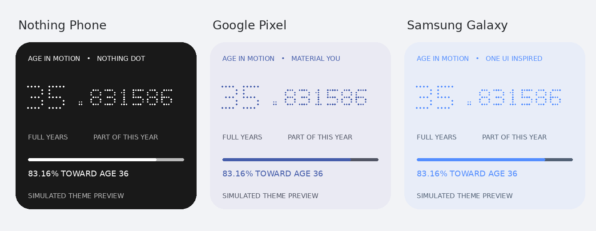

# Age in Motion — Universal Android v4

**A home-screen age widget for Nothing Phone, Google Pixel, Samsung Galaxy, and other compatible Android devices.** Designed for Android **8.0+ (API 26+)** using standard Android AppWidget APIs. It works only in a launcher that allows third-party home-screen widgets; individual devices and launchers have **not** all been tested.

Inspired by **[Rahul’s original Age in Motion on Nothing Playground](https://playground.nothing.tech/detail/app/A0iu5DKA7eGhHhZD)**. A huge salute and thanks to Rahul for the original concept! This is an independent, unofficial recreation, not endorsed by or associated with Nothing, Samsung, Google or Rahul.

## New in v4 — universal device themes

The app reads Android's standard `Build.MANUFACTURER`, `Build.BRAND`, `Build.MODEL`, and Android version locally, then chooses a starting theme:

| Device family | Automatic preset | Notes |
| --- | --- | --- |
| Nothing Phone | **Nothing Dot** | Monochrome dot-matrix look, preserving the Nothing-inspired edition |
| Google Pixel | **Pixel / Material You** | Softer rounded surfaces, wallpaper-derived Android accent on Android 12+ when available |
| Samsung Galaxy | **Samsung / One UI** | Samsung-inspired softer blue surfaces (unofficial) |
| Other Android 12+ | **Material You** | Android system accent where supported |
| Older/other Android | **Classic monochrome** | High-contrast fallback requiring no manufacturer APIs |

**Manual controls:** Widget Theme = Automatic / Nothing Dot / Pixel / Samsung / Material You / Classic; Appearance = Follow system / Dark / Light. You can use any preset on any supported Android phone. Themes are original UI styles **inspired** by manufacturer design languages, not official manufacturer widgets. The selected theme and appearance are stored locally.

The **widget and settings preview** now adapt their text, card surfaces, dot color, rounded corners and progress accent. Pixel/Material You attempts to read platform dynamic system colors on Android 12+; on unsupported OEM builds it uses safe fallback accents. Material colors can differ across launchers and firmware. Older Android gets static color palettes.

### Why the number looks like `35.83158642`
- `35` means **35 completed birthdays**.
- `.83158642` means **about 83.16% of the way from the 35th to the 36th birthday**, not months or seconds.
- The last decimal digits change when Smart Motion is enabled.
- A progress bar and a label show the percentage toward the next birthday.

## Smart Motion and battery

**Opt in** to Smart Motion if you want the age fraction to animate on your home screen. It updates for about **2 seconds per frame for the first 90 seconds after unlock**, then **about every 10 seconds**; it pauses redraws after five minutes or whenever the device is locked or the screen is off. Battery Saver uses about 15 seconds instead. Updates can be throttled by Android or manufacturer battery optimizations. The optional service uses a visible notification and no wakelock. **Eco mode** disables the service and uses standard system-scheduled widget updates (normally around every 30 minutes) plus manual refresh.

Android does not reliably tell standard unprivileged third-party apps when *only the home launcher* is visible. Smart Motion therefore runs for a limited unlocked-screen window even while another app is in the foreground; it cannot guarantee animations solely when the launcher is visible.

## Home screen vs lock screen

- **Home screen:** standard resizable Android app widget, recommended **4 × 2** cells; the new minimum is sized to fit more 3 × 2 layouts where the launcher allows it. Smaller widgets may display reduced readability.
- **Lock screen:** Android/OEM launchers control their own lock-screen widget support. This project cannot force support on Nothing OS 3.2, Google Pixel or Samsung lock screens. The optional *age notification* is not a lock-screen widget and depends on notification privacy settings.
- **Always-on display (AOD):** no custom native AOD support.

## Screenshots

*Illustrative theme comparison. Actual appearance depends on device theme colors, launcher dimensions, and Android version; this is not a physical-device screenshot.*

*Earlier v3 Nothing-inspired design (sample age); the actual v4 colors change with the selected device theme.*

## Build and install an APK (without Android Studio)

1. Upload the project's extracted files to your GitHub repository, preserving nested folder paths, and commit to `main`.
2. Open **Actions → Build Android APK**, and open the latest successful run.
3. Download **AgeInMotion-NothingOS3-APK** from *Artifacts*, then extract `app-debug.apk`.
4. Install on your Android phone, open the app, select a date of birth, choose Automatic or your preferred theme, and place **Age in Motion Widget** on your home screen.
5. Enable Smart Motion only if you want short bursts of changing digits; otherwise leave it off for better battery life.

The APK build uses Android Gradle Plugin 8.7.3, Gradle 8.9, JDK 17 and SDK 35. Debug APK signing can vary from one GitHub Actions runner to another: if Android rejects an update due to a signing conflict, uninstall the prior debug version (this deletes saved data and may remove widgets) before installing. For sharing publicly, create a consistently signed release APK.

## Privacy and permissions

Your birthday and display preferences stay in local SharedPreferences. The project requests no `INTERNET` permission, uses no advertising SDK or analytics, and requires no root. Smart Motion uses a user-started foreground service and notification; the optional lock-screen notification showing age is off by default. Phone model detection uses only the Android Build properties and isn't transmitted anywhere.

## Compatibility and testing status

- Minimum SDK **26 (Android 8.0)**, target SDK **35 (Android 15)**.
- Source and resource files prepared for compilation. The **v4 APK has not yet been built or tested on physical Pixel, Galaxy or other OEM devices**. Detection and preset selection are implemented in source; actual appearance and motion must be tested per launcher and Android build.
- No claim of compatibility with **every** Android model or native lock-screen widgets.
